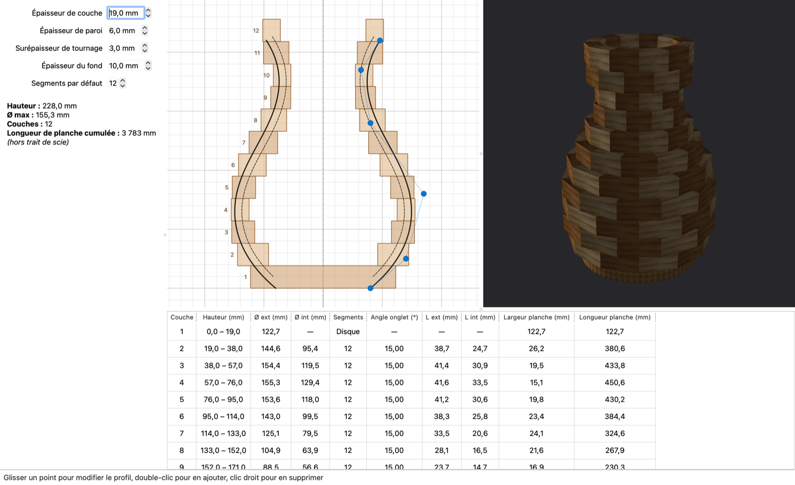

# QtWSeg — conception de pièces tournées segmentées

**QtWSeg** aide à préparer le **tournage segmenté** (*segmented woodturning*) : on dessine le profil d'un vase, d'un bol ou d'un djembé avec une courbe B-spline, et le programme calcule couche par couche les segments à découper (nombre, angle d'onglet, longueurs, largeur de planche) pour reconstituer la pièce.

[](https://github.com/clebail/qtwseg/actions/workflows/release.yml)
[](LICENSE)

**[⬇️ Télécharger la dernière version](https://github.com/clebail/qtwseg/releases/latest)** pour macOS, Windows ou Linux : aucune installation de Qt n'est nécessaire.



---

## Fonctionnalités

### ✏️ Édition du profil
- Profil extérieur défini par une **B-spline cubique** qui passe par le premier et le dernier point de contrôle.
- Édition à la souris :
  - **glisser** un point pour le déplacer ;
  - **double-clic** pour ajouter un point sur le polygone de contrôle ;
  - **clic droit** pour supprimer un point.
- Le profil intérieur est calculé automatiquement en décalant le profil extérieur de l'épaisseur de paroi.
- Vue en demi-coupe symétrisée, avec une grille millimétrée (10 mm et 50 mm) et la section de bois de chaque couche numérotée.
- Coordonnées du curseur en millimètres dans la barre d'état.

### 🧊 Aperçu 3D
- Rendu OpenGL des anneaux segmentés, texturés bois.
- Couches **montées en quinconce** : une couche sur deux est décalée d'un demi-segment, comme en atelier.
- Segments alternativement clairs et foncés pour voir les joints.
- Rotation à la souris (clic gauche ou droit) et zoom à la molette.

### 📐 Calcul du découpage
Paramètres réglables :

| Paramètre | Rôle |
|---|---|
| Épaisseur de couche | Épaisseur des planches, donc hauteur de chaque anneau |
| Épaisseur de paroi | Épaisseur de la paroi une fois tournée |
| Surépaisseur de tournage | Matière ajoutée de chaque côté de la paroi |
| Épaisseur du fond | Les couches qui touchent le fond deviennent des disques pleins (`0` = pièce ouverte, ex. djembé) |
| Segments par défaut | Nombre de segments des couches sans réglage particulier |

Le **nombre de segments peut être changé couche par couche** directement dans le tableau, ce qui change l'angle d'onglet de cette couche.

Pour chaque couche, le plan de découpe donne :

| Colonne | Description |
|---|---|
| Hauteur | Position de la couche (mm) |
| Ø ext / Ø int | Diamètres à couvrir, surépaisseur comprise |
| Segments | Nombre de segments (ou *Disque* pour un fond plein) |
| Angle onglet | Angle de coupe de chaque extrémité : `180° / N` |
| L ext / L int | Grand et petit côté du trapèze |
| Largeur planche | Largeur de planche nécessaire |
| Longueur planche | Longueur de planche pour l'anneau (coupes alternées, hors trait de scie) |

Un résumé donne aussi la hauteur totale, le diamètre maximal, le nombre de couches et la longueur de planche cumulée.

### 💾 Fichiers et exports
- **Enregistrer et ouvrir** un projet au format JSON (`.qws.json`).
- **Export CSV** : séparateur point-virgule et UTF-8 avec BOM, pour s'ouvrir directement dans Excel ou LibreOffice en français.
- **Export PDF** : feuille d'atelier A4 avec le profil coté, les paramètres et le tableau de découpe (sur plusieurs pages si besoin).

---

## Principe de calcul

Chaque couche est un polygone régulier de **N** segments trapézoïdaux, de demi-angle `a = π / N`.

- **Rayon extérieur** `R` : rayon maximal du profil sur la hauteur de la couche, plus la surépaisseur.
- **Rayon intérieur** `r` : rayon minimal du profil intérieur sur la hauteur de la couche, moins la surépaisseur.

Le polygone est dimensionné pour que la pièce finie soit **toujours contenue dans le bois** :

- son apothème extérieur vaut `R`, donc le polygone contient le cercle extérieur ;
- ses coins intérieurs sont sur le cercle de rayon `r`, donc la matière ne déborde pas à l'intérieur.

D'où :

```
angle d'onglet    = 180° / N
L ext             = 2 · R · tan(a)
L int             = 2 · r · sin(a)
largeur planche   = R − r · cos(a)
longueur planche  = N · (L ext + L int) / 2
```

---

## Exemple fourni

[`exemples/djembe-30x60.qws.json`](exemples/djembe-30x60.qws.json) : un djembé de **30 cm de diamètre** et **60 cm de haut**, sans fond, paroi de 12 mm, 16 segments par couche, soit 32 couches en planches de 19 mm.

### Format du fichier

```json
{
    "version": 1,
    "params": {
        "layerHeight": 19,
        "wallThickness": 12,
        "turningMargin": 3,
        "bottomThickness": 0,
        "defaultSegments": 16
    },
    "points": [[115, 0], [118, 40], [85, 140], [60, 260], [70, 340], [125, 410], [152, 500], [150, 600]],
    "segments": { "5": 12 }
}
```

- `points` : points de contrôle `[rayon, hauteur]` en millimètres, du pied vers le haut.
- `segments` : nombre de segments imposé pour certaines couches (index à partir de 0).

---

## Installation

Téléchargez le fichier correspondant à votre système sur la [page des versions](https://github.com/clebail/qtwseg/releases/latest) :

| Système | Fichier | Remarque |
|---|---|---|
| macOS (Intel et Apple Silicon) | `QtWSeg-…-macos.dmg` | Application non signée : au premier lancement, faites **clic droit → Ouvrir** |
| Windows 10/11 (64 bits) | `QtWSeg-…-windows-x64.zip` | Décompressez, puis lancez `qtwseg.exe` |
| Linux (x86_64) | `QtWSeg-…-linux-x86_64.AppImage` | Rendez le fichier exécutable (`chmod +x`), puis lancez-le |

---

## Compilation

Le projet nécessite **Qt 6.9 ou plus récent** (modules `widgets`, `opengl` et `openglwidgets`) et un compilateur C++17.

### macOS (Homebrew)
```sh
brew install qt
qmake6 qtwseg.pro
make
open qtwseg.app
```

### Linux (Debian / Ubuntu)
```sh
sudo apt install qt6-base-dev libgl1-mesa-dev build-essential
qmake6 qtwseg.pro
make
./qtwseg
```

### Windows
Ouvrir `qtwseg.pro` dans **Qt Creator** (Qt 6) et compiler.

> 💡 Pour garder les sources propres, compilez dans un dossier séparé : `mkdir build && cd build && qmake6 ../qtwseg.pro && make`.

### Publier une version

Les binaires sont fabriqués par GitHub Actions ([`.github/workflows/release.yml`](.github/workflows/release.yml)). Pousser un tag `v*` compile les trois plateformes et publie automatiquement une *Release* :

```sh
git tag v1.0.0
git push origin v1.0.0
```

Le workflow peut aussi être lancé à la main depuis l'onglet **Actions**. Dans ce cas, les binaires sont seulement disponibles en artefacts, sans *Release* publiée.

---

## Organisation du code

| Fichier | Rôle |
|---|---|
| `CBSpline` | Évaluation de la B-spline (algorithme de De Boor) |
| `CVase` | Modèle : points de contrôle, paramètres, profil intérieur, découpage en couches, sauvegarde JSON |
| `CCouche` | Une couche et la géométrie de ses segments |
| `CProfileEditor` | Éditeur 2D du profil, dont le rendu sert aussi au PDF |
| `C3dView` | Aperçu 3D OpenGL des anneaux |
| `CExport` | Colonnes du plan de découpe, exports CSV et PDF |
| `CMainWindow` | Fenêtre principale, paramètres, tableau et menus |

---

## Limites et pistes

- Le trait de scie n'est pas pris en compte dans les longueurs.
- Les coupes sont droites (onglet seul, sans inclinaison de lame).
- Le profil intérieur est un décalage du profil extérieur : une courbe concave plus serrée que l'épaisseur de paroi peut le faire se croiser lui-même.

Pistes d'évolution : paramètre de trait de scie, débit regroupé par planche, coupes composées pour les parois très évasées.

Les contributions sont les bienvenues : issues et pull requests !

---

## Licence

Ce projet est versé dans le **domaine public** sous [The Unlicense](LICENSE) : vous pouvez le copier, le modifier, le distribuer et l'utiliser, y compris commercialement, sans aucune condition.
